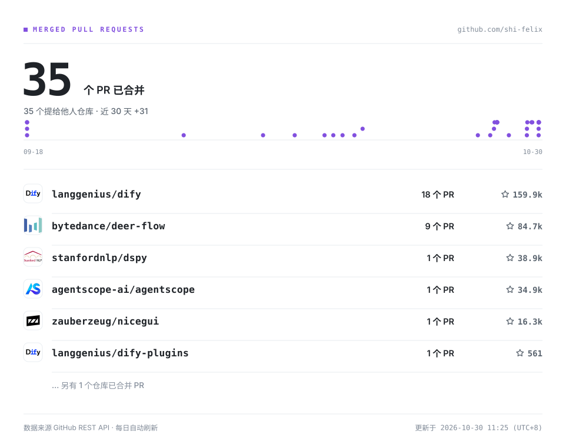

<picture>
  <source media="(prefers-color-scheme: dark)" srcset="./assets/hero-dark.svg">
  
</picture>

<picture>
  <source media="(prefers-color-scheme: dark)" srcset="./assets/merged-prs-dark.svg">
  
</picture>

<!-- STATS:BEGIN -->
**37** 个 PR 已被合并（37 个提给他人仓库）· 数据由 [`generate_stats.py`](./scripts/generate_stats.py) 每日直连 GitHub API 刷新
<!-- STATS:END -->

## 代表项目

**TinyCode** —— 一个「能在一个下午读完」的完整 Coding Agent Harness：模型接入 · Agent 循环 · 工具 · 权限 · 会话 · 上下文工程 · Skills · MCP · 子代理 · TUI，十个子系统一个不少。

[仓库](https://github.com/shi-felix/tinycode) · MIT · TypeScript · `47 个源文件 / 15 个测试文件` · `约 6.6k 行` · 基于 Pi Agent Runtime · 附 27 篇源码拆解文档

---

<picture>
  <source media="(prefers-color-scheme: dark)" srcset="https://raw.githubusercontent.com/shi-felix/shi-felix/output/github-contribution-grid-snake-dark.svg">
  
</picture>
